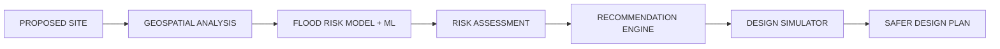

# FloodShield AI — Hackathon Pitch Deck (10 slides)

Tagline: **Predict. Redesign. Prevent.**

## Slide 1 — Title
**FloodShield AI — Pre-Construction Flood Risk & Resilience Planner**
🏗️ → 🌧️ → 🌊 → 🛡️ | Team name + members.

## Slide 2 — Problem: flood risk begins before construction
Urban Expansion → More Impervious Surface → Higher Runoff → Drainage Stress → Urban Flooding.
Current systems monitor and respond. Ours prevents — at the planning stage, when fixes are cheap.

## Slide 3 — Why existing approaches are not enough
| Traditional | FloodShield AI |
|---|---|
| Detect flooding | Prevent / reduce risk |
| Flood maps | Construction-aware analysis |
| Existing conditions | Evaluates proposed development |
| Shows risk | Recommends interventions |
| Reactive / static | Preventive / what-if simulation |

## Slide 4 — Solution
PROPOSED SITE → SITE ANALYSIS → FLOOD RISK MODEL → PROBLEM DETECTION → AI RECOMMENDATIONS → DESIGN SIMULATOR → SAFER DESIGN.
*From "where will flooding happen?" to "how should we build differently?"*

## Slide 5 — How it works (data pipeline)
12 inputs — rainfall, elevation, slope, distance to water, drainage density, soil infiltration, impervious %, footprint, flood history, plinth, **land-use change, upstream catchment** → Random-Forest risk engine + gradient-descent flow-path tracer → risk + recommendations. Persisted in PostGIS; 2D map and 3D twin render the same stored payload.

## Slide 6 — Key innovation: more than a flood map
🗺️ Natural flow detection (traced drainage paths, building-intersection flags) · 🤖 Site-specific recommendations with map placement · 🔄 One-click before/after simulation · 🏗️ Six-parameter resilience score.

## Slide 7 — Demo (the story)
Residential complex → per-factor ratings (Elevation HIGH, Drainage HIGH…) → risk 78 → map shows building on flow corridor → 6 recommendations → **Apply Recommended Design** → risk 54, resilience up, badge upgrade, corridor preserved. Screenshots from the app.

## Slide 8 — Technology
React + Three.js · Spring Boot REST · PostgreSQL + PostGIS · Python + scikit-learn (RF v2, 12 features) · Leaflet. Supervised Docker deployment with health checks.

## Slide 9 — Impact
🏗️ Developers catch risk early · 🏙️ Planners evaluate proposals on evidence · 🌱 Drainage and infiltration preserved · 👨‍👩‍👧 Communities face less disruption. Prevention is cheaper and safer before construction. *(No specific cost-reduction claims.)*

## Slide 10 — Future vision
From flood-risk mapping → climate-resilient construction planning. Next: real-time rainfall, IoT sensors, full hydrology, BIM integration, approval support, climate scenarios, multi-hazard.
**"Build for the future, not for the last flood."**

### Speaker notes — USP (say verbatim)
Existing systems ask *"where will flooding occur?"*. FloodShield AI asks *"where should we build, how should we build, and what should we change before construction?"*

